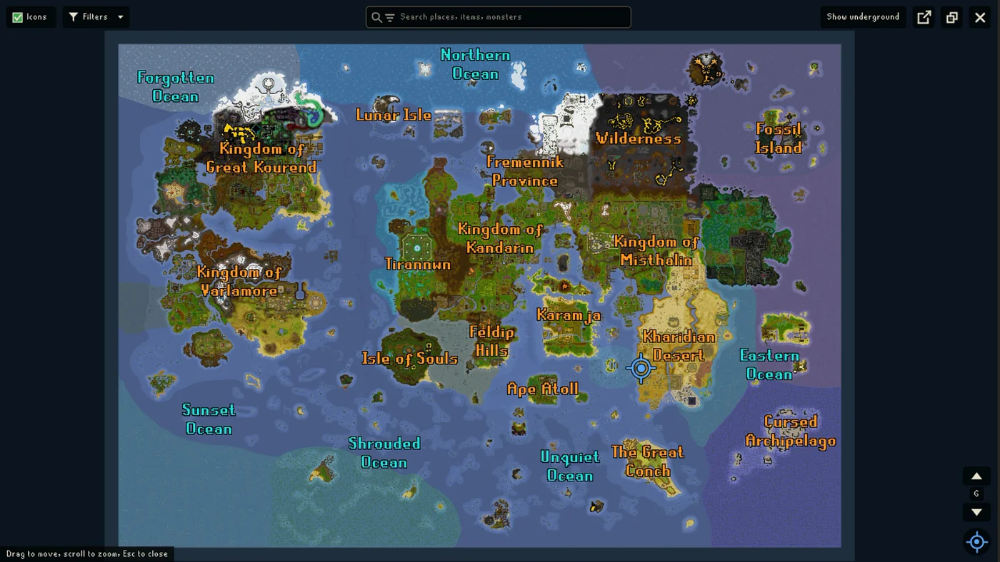
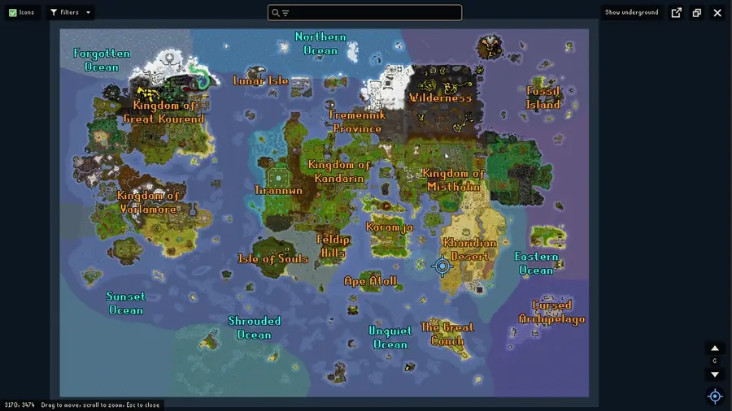
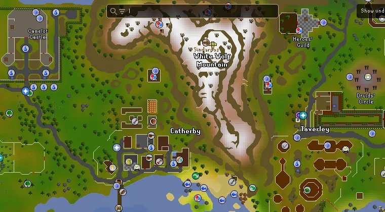
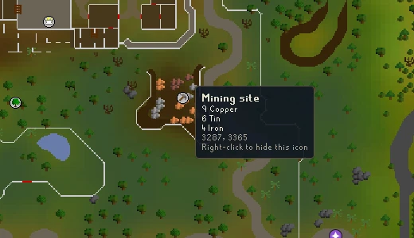
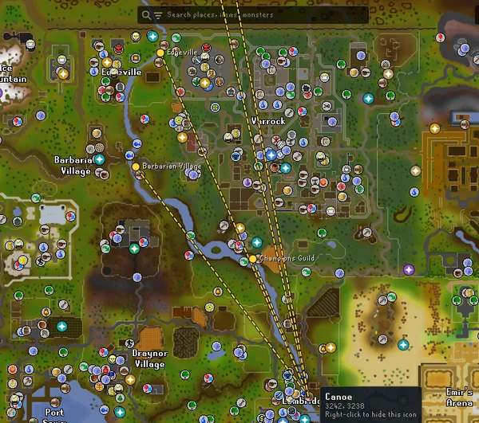
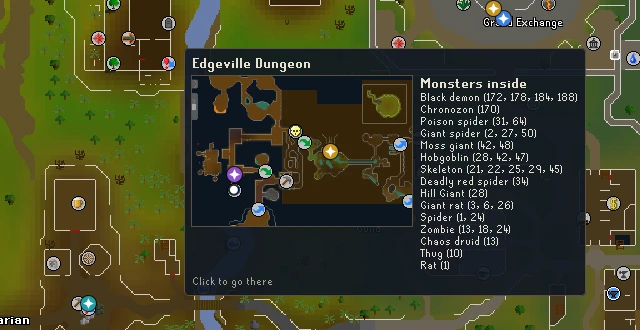
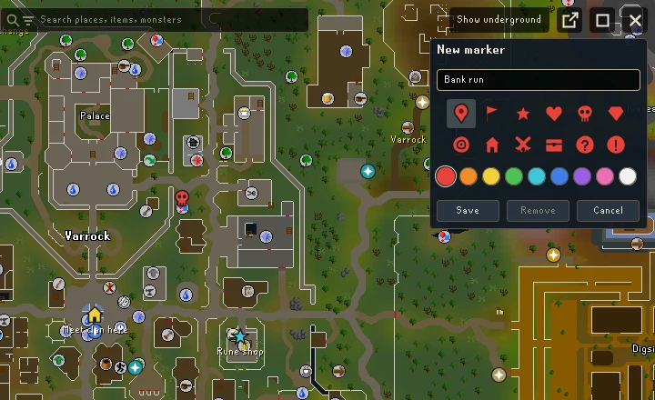
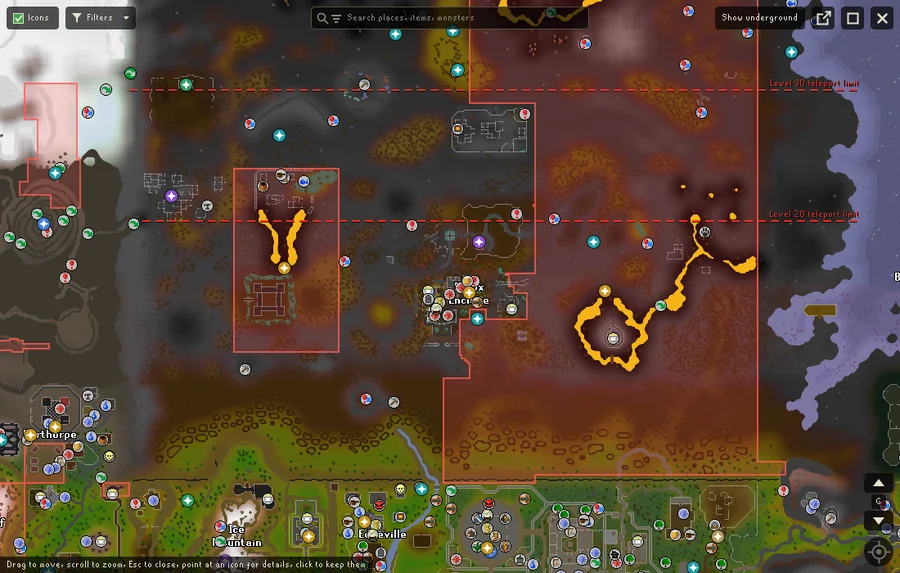

# Advanced Map

A full-screen world map for [RuneLite](https://runelite.net/), drawn on your computer from the game's own map data,
with smooth pan and zoom, a fuzzy search over places, shops, items and monsters, and icons you can point at for
their details.



- **Always current.** The map is drawn from the game data your client already has, so a game update that changes the
  world shows on the map at once. Nothing is downloaded and nothing is sent anywhere.
- **Over the game, or beside it.** Open it in a box over the game that you can move and size, fill the game view
  with it, or pop it out into a window of its own for a second screen.
- **Find anything.** "d scim", "kbd", "ardy", "lobster", "cks", "bank": places, dungeon entrances, what shops
  sell, monsters, fishing and hunter spots, fairy ring codes and kinds of icon, nearest to you first.
- **Know before you go.** Point at a dungeon's entrance for a small map of where you come out and every monster
  inside; point at a quest, a shortcut or a teleport for what it needs.



## Getting started

Install **Advanced Map** from RuneLite's Plugin Hub, then open the map in any of these ways:

- **Ctrl+M** (change the key in the settings). Ctrl+M again or the close button close it, and so does Escape
  while the pointer is on the map.
- The **Advanced Map** tab in RuneLite's sidebar. Its "How the map works" section explains each part of the map.
- Right-click the **world map orb** by the minimap and choose "Open Advanced Map".

The map opens on your character, on the surface or the underground map, whichever you are on.

## Controls

| To | Do |
|---|---|
| Move the map | Drag it |
| Zoom | Scroll, around the pointer |
| Go back to your character | The round button at the bottom right (it keeps following you until you drag) |
| Change floor | The arrows above that button |
| Switch surface / underground | The button at the top |
| See what an icon is | Rest the pointer on it; click it to keep its box open |
| Add a marker, route somewhere, hide an icon | Right-click the spot or the icon |
| Choose which icons show, and mark your Slayer task | The Filters button at the top left |
| Search | Click the search box at the top and type; Enter or a click on a result goes there |
| Choose what the search looks in | The three lines beside the magnifying glass |
| Move or size the box over the game | Drag its top or bottom bar, or a corner |
| Fill the game view with the map | The square button next to the close button |
| Pop the map out into its own window | The button with an arrow leaving a window, at the top right |
| Close a search, a list or an info box | Escape, with the pointer on the map (then Escape again closes the map) |

While the box is open the game goes on around it: a click beside the box is the game's, and so is Escape with
the pointer over the game (closing the bank, say), unless you are typing in the search box. While you type in the
search box, the F-keys still open the game's tabs.

## What's on the map

### Search

The box at the top finds places, dungeon and minigame entrances, everything shops sell, monsters and NPCs, matched
loosely the way the Grand Exchange does ("d scim" and "dragon sim" both find the dragon scimitar, "kbd" the King
Black Dragon). Places come first, the bigger first, and nicknames work ("ardy", "fally", "zeah").



- **A place** moves the map there.
- **An item** lists the shops that sell it and the price, nearest first. Items that lie on the ground (a knife on a
  table, a bucket by a well, flax in a field) are a result of their own: every spot marked, listed by area, nearest
  first.
- **A monster or NPC** marks every spawn and lists them by area. A monster comes with its hitpoints, max hit,
  weakness, Slayer level and masters, sure and rare drops, and a button to its wiki page.
- **Fairy ring codes** ("cks"), **fishing spots by catch** ("lobster"), **hunter areas by creature**
  ("chinchompa") and **kinds of icon** ("bank", "anvil", "altar": every one, nearest first) are found too.

Shops are found through what they sell; turn on "Search finds shops by name" to list them by name as well.

**Search in**: the three lines beside the magnifying glass open a list of every kind of result (places, dungeons and
minigames, map icons, fairy rings, shops and what they sell, items on the ground, monsters, NPCs, fishing and hunter
spots, your markers). Untick a kind to leave it out of the results; "Search everything" ticks them all again. The
lines light up while something is left out, and a search that finds nothing says how many kinds are off. The choice
is kept between sessions.

### Icons

Banks, quests, shops, shortcuts, teleports and every other icon of the game's map, each with details on hover or
click: a quest's difficulty and the levels it needs, a shortcut's Agility level, a spell's Magic level and quest.
Where the game's map only says what kind of place it is, this one says what is there: a mining site's rocks, a
fishing spot's catch, a hunter area's creature and Hunter level, a rare tree's kind, and each minigame's name.



- Agility shortcuts and teleport spells you can't use yet are grayed out with a red mark, and finished quests are
  left out (both can be turned off).
- Banks the game's map leaves out get an icon too (the Culinaromancer's Chest in Lumbridge Castle's cellar, the
  Lovakengj blast mine's other chests ...). Bank chests you build yourself and banks a quest opens stay grayed out
  until you have built or opened them; click one for what it needs.
- **Shops**: click one, general stores included, for what it sells and for how much.
- **Transports**: point at a charter ship, a canoe, a spirit tree or another transport for lines to where it goes;
  click it to keep them and list each place with the fare and what the trip needs. Fairy ring codes and spirit tree
  destinations show beside them when zoomed in.
- **Minigames the game's map leaves out** get an icon of their own, such as Tempoross at the Sea Spirit Dock.


- **Filters** at the top left lists every kind of icon, grouped (Banks, Quests, Shops ...) and searchable: tick or
  untick a whole group or a single kind. Right-click any one icon to hide just that one; "Show hidden icons" brings
  them back faded so they can be unhidden.

### Dungeons and floors

- **Dungeon preview**: point at a dungeon's entrance for its name, a small map of where you come out, and every
  monster inside, down its ladders and ropes to the lower floors too. Click the entrance to go in.

  

- **Floors**: the floors below the one shown are drawn darkened underneath, so you can see where you are. Zoomed
  out, the ground floor shows every floor's icons, as the game's map does; zoomed in, each icon is on its own floor.
- **Prifddinas** is drawn inside its walls in Tirannwn, with its icons, teleports and transports, although the game
  keeps the city on a map of its own.

### Your own markers

Right-click anywhere and choose "Add marker here", give it a name and pick one of 12 pictures and 9 colors.
Right-click a marker to edit or remove it; the search finds markers too. Markers are shared by every account you play
on this computer, two clients at once included; turn off "Share markers between accounts" to keep each account's own.



### Extra layers

- **Wilderness teleport limits**: zoomed in, red dashed lines show where the Wilderness passes level 20 and level
  30, above which most teleports stop working.
- **Multi-combat areas** (off by default): tinted red with a solid edge when zoomed in, in the Wilderness and
  everywhere else.
- **Farming patches**: a dot on each patch icon, green ready, yellow growing, red diseased or dead, gray empty;
  click one for its crop and when it is ready. Read from what RuneLite's Time Tracking plugin saved.
- **Your Slayer task** (off by default): tick it at the top of the Filters list to mark every spawn of your task's
  monsters, with how many are left. The row names the task RuneLite's Slayer plugin keeps, or says there is none.
- **Other plugins' markers**: a clue scroll's spot, Quest Helper's next step and other plugins' world map markers
  show on this map as well.
- **Arrow to you**: when you are out of view, an arrow at the map's edge points to you with how many tiles away.



### Routes

Right-click anywhere on the map, or on an icon, and choose "Route here" to have
[Shortest Path](https://runelite.net/plugin-hub/show/shortest-path) or [GPS](https://runelite.net/plugin-hub/show/gps)
show the way ("Route with" in the settings). The plugin you pick must be installed and on.

## Settings

Every setting is in Advanced Map's entry in RuneLite's configuration panel. Which kinds of icon show is easiest to
choose with Filters on the map itself.

| Setting | Default | What it does |
|---|---|---|
| Open or close the map | Ctrl+M | The key that opens and closes the map |
| World map orb menu entry | On | "Open Advanced Map" in the world map orb's right-click menu |
| World map orb opens Advanced Map | Off | A left click on the orb opens this map; the game's own map stays in the orb's menu |
| Sidebar button | On | The sidebar tab with the open button and the saving progress |
| Open in its own window | Off | Opens the map popped out instead of over the game |
| Info on hover | On | Shows an icon's details when the pointer rests on it; off, a click shows them |
| Dungeon monsters | Highest level first | The order a dungeon preview lists its monsters in |
| Arrow to you | On | The arrow at the edge pointing to you when you are out of view |
| Wilderness teleport limits | On | The level 20 and 30 lines |
| Multi-combat areas | Off | The multi-combat tint |
| Farming patch status | On | The dots on farming patch icons |
| Other plugins' markers | On | Other plugins' world map markers |
| Search finds shops by name | Off | Shops in the search results by their own names |
| Share markers between accounts | On | Your markers on every account, or only on the one they were made on |
| Place names | On | Kingdom, town and place names |
| Floor numbers | Ground, 2, 3, 4 | How floors above the ground are numbered (or Ground, 1, 2, 3) |
| Route with | Shortest Path | The plugin "Route here" asks |
| Prepare the whole map | On | Draws the rest of the map in the background, nearest you first (about 15 minutes, once) |

The **Icons** section holds a switch per kind of icon (the same as Filters), "Hide completed quests", "Mark what
you can't use yet", "Icon size" and "Transport names".

## Privacy and what it uses

- **The map is drawn from your own client's game data.** Nothing is downloaded, at startup or ever, and the plugin
  makes no network connections.
- **Shops, prices, monster spawns, stats and drops** come from the Old School RuneScape Wiki, bundled with the
  plugin when it is built (see Credits). They are updated with each release of the plugin.
- **What it reads in the client**: your position, levels, quest states and what you have unlocked (for the locked
  marks and the finished quests), and, read only, what RuneLite's Time Tracking and Slayer plugins have saved. It
  changes nothing of theirs.
- **What it keeps on your computer**, in RuneLite's plugin data folder: the drawn map (about 60 MB for the whole
  world), so it opens at once, and one small file per marker.
- **The two buttons beside the sidebar tab's title** open this project's GitHub issues and Discord in your browser,
  only when you click them.

## Good to know

- **The first time.** From the moment the client starts, the map draws the regions it has not saved yet in the
  background, nearest you first, using spare processor time: about 15 minutes for the whole world, once per
  computer, shared by every account and profile. Until then places not drawn yet are blank or blurry, and the map
  says "Drawing the map... N to go" at the top left; the sidebar tab shows the same count. Afterwards the map opens
  at once, and a region is drawn again only when a game update changes it. "Prepare the whole map" off draws only
  what you look at.
- **Memory.** While the map is open it keeps the pictures it has drawn at hand, so moving back over them is
  instant; closing it lets go of the most detailed ones.
- **After a game update**, new and changed areas, buildings and the game's own map icons show at once, since they
  are drawn from your client. New shops, monsters and their drops show in the search once the plugin is updated, and
  a brand-new quest's started or finished state once RuneLite knows the quest.
- **Key Remapping**: with RuneLite's Key Remapping plugin on, the letters it remaps are still typed into the search,
  but Enter on a result also unlocks the game's chat, as that plugin does for any Enter. Press Escape or click the
  chat to lock it again.

## For plugin authors

Other plugins can draw lines and markers on the map through RuneLite's `PluginMessage`, in world coordinates
(`WorldPoint`). Namespace `advancedmap`:

| Message | Data | Does |
|---|---|---|
| `layer` | `id` (String, required, start it with your plugin's name), `order` (Number, higher on top), `lines` (List of Maps: `points` List of `WorldPoint`, `color` `Color`, `width` Number, `dashed` Boolean), `markers` (List of Maps: `point` `WorldPoint`, `color` `Color`, `shape` `"circle"`, `"square"` or `"diamond"`, `size` Number, `label` String) | Draws a layer, replacing one with the same `id` |
| `removeLayer` | `id` | Removes a layer |
| `show` | `point` (`WorldPoint`), `zoom` (Number, optional: screen pixels per tile) | Opens the map on a point |

The map posts `state` with `open` (Boolean) when it opens or closes.

```java
Map<String, Object> line = new HashMap<>();
line.put("points", List.of(new WorldPoint(3222, 3218, 0), new WorldPoint(3210, 3424, 0)));
line.put("color", Color.CYAN);

Map<String, Object> layer = new HashMap<>();
layer.put("id", "myplugin:route");
layer.put("lines", List.of(line));
eventBus.post(new PluginMessage("advancedmap", "layer", layer));
```

Plugins that put markers on RuneLite's world map through `WorldMapPointManager` show on this map without any change.

## Feedback

Questions, ideas and bug reports: [GitHub issues](https://github.com/Brettgod1355/Advanced-Map/issues), or ask on
[Discord](https://discord.gg/c85DK83jWx).

## Credits and license

- The map drawing is RuneLite's own map renderer from its cache library (BSD 2-Clause), adapted to read the running
  client.
- Shops, their stock and prices, monster spawns, stats and drops, and the hunter areas RuneLite's list leaves out
  come from the [Old School RuneScape Wiki](https://oldschool.runescape.wiki/) (CC BY-NC-SA 3.0).
- Mining sites, rare trees, fishing spots, hunter areas, dungeon and minigame entrances come from RuneLite's own
  world map plugin (BSD 2-Clause).
- Transport routes and fares come from [Shortest Path](https://github.com/Skretzo/shortest-path) (BSD 2-Clause).

Every bundled source, its license and what was changed are listed in
[THIRD_PARTY_NOTICES.md](THIRD_PARTY_NOTICES.md). Advanced Map itself is under the BSD 2-Clause license
([LICENSE](LICENSE)).

Advanced Map is not affiliated with Jagex or RuneLite. Old School RuneScape is a trademark of Jagex Ltd.
